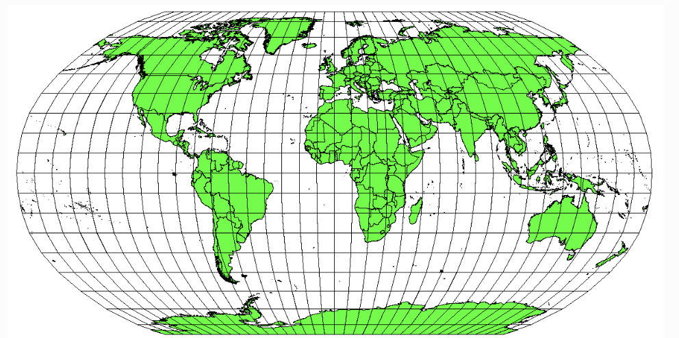

# Tool Learning Log

## Tool: **Leaflet**

## Project: **Wheelchair GPS**

---

## LL1

### 10/19/26-10/23/26
* started browsing on leaflet 
    * started looking at the quick start guide for leaflet 
        *  to start using leaflet, copy and paste the given css file link and include a javascript file AFTER leaflet css
        *  Then, create a id where you want your given map to be 
        * make sure to include a defined height in a css file 
    * I first tinkered with the setup process to see if it would work 
    * then I decided to tinker with the different coordinate locations 
        EX:
        ```js
        const map = L.map('map').setView([10, -0.203], 13); //Im still not sure what this does 

        L.tileLayer('https://tile.openstreetmap.org/{z}/{x}/{y}.png', {
        attribution: '&copy; OpenStreetMap contributors'
        }).addTo(map);

        L.marker([-20, -10]) // changing these given coordinates changed the position of the marker to the ocean!
        .addTo(map)
        .bindPopup('you are currently here')
        .openPopup();
        ```
    * based off of this, leaflet uses a different coordinate system with maps which may be confusing to understand 
* Although my tool works for customizing maps and makes the whole process of making a map more easier, I still need a tool that could help with APIS and GPS features 
* Im going to try to tinker more with the different pins and also customizable markers that are in leaflet and research more on tools that use GPS for people with disabilities. 


* started testing out different pins and customizable marker 
    * theres many different shapes you can add such as triangles, circles, polygons, and you can customize their color, opacity, and radius for circles 
    EX:
    ```js 
    //circle example 
    var circle = L.circle([51.508, -0.11], {
    color: 'red',
    fillColor: '#f03',
    fillOpacity: 0.5,
    radius: 500
    }).addTo(map);

    //polygon/triangle example 
    var polygon = L.polygon([
    [51.509, -0.08], // this represents the first point 
    [51.503, -0.06], // second point 
    [51.51, -0.047] //third point and so on... 
    ]).addTo(map);

    //marker evample
    var marker = L.marker([51.5, -0.09]).addTo(map);
    ```
* I noticed that you can also create popups that when the user clicks on a specific part of the map the alert states their given coordinate 
    EX:

    ```js
    var popup = L.popup();

        function onMapClick(e) {
        popup
            .setLatLng(e.latlng) 
            .setContent("You clicked the map at " + e.latlng.toString()) // this is the text that will be shown in the alert
            .openOn(map); // this action will open the alert on the map 
        }
        map.on('click', onMapClick); // map.on is allowing for the function to be called 
    ```

* I tinkered more with the shapes and realized that with polygons, you can change its shape to whatever position of your choice. This can allow for the creation of even more shapes like squares, rectangles, octagons, pentagons etc... 
* im still unsure as to what the different commands and actions inside of the functions do so I may need to research more about how these commands may work 
* Im going to learn how to implement these concepts into a mobile device if possible 


* I started looking into the [leaflet on Mobile](https://leafletjs.com/examples/mobile/) tutorial 
    * to first set up the mobile positioning, you need to use specific css code 
        EX:
        ```js
        body {
        padding: 0;
        margin: 0;
        }
        html, body, #map {
        height: 100%;
        width: 100vw; // note: its recommended to use vh for websites such as google chrome
        }
        ```
    * then you must place a line of code in the head of an html page which allows for the height of a given change to have a defined height and not its default 
        EX:
        ```html
        <meta name="viewport" content="width=device-width, initial-scale=1.0, maximum-scale=1.0, user-scalable=no" />  
        ```

    * to allow for detection of user location, **geolocation** must be used to determine someones location which is done in javascript using the ``.locate`` and ``setview`` javascript methods 
    * Although you only need to add this, you can also include markers to allow for more detail. In the document example, a function is created that uses the radius to determine how far in a specific amount of meters that you would be away from your house and ends it off with an error message just in case the location cannot be determined 
        EX:
        ```js
        code for head of html:
        map.locate({setView: true, maxZoom: 16}); 

        code for javascript:
        function onLocationFound(e) {
        var radius = e.accuracy;

        L.marker(e.latlng).addTo(map)
        .bindPopup("You are within " + radius + " meters from this point").openPopup();

        L.circle(e.latlng, radius).addTo(map);
        }

        function onLocationError(e) { // this will give an error message to the user
        alert(e.message);
        }

        map.on('locationerror', onLocationError);

        map.on('locationfound', onLocationFound);
        ```
    * I need to research more on the coordinate system for leaflet because I dont seem to understand how the positioning of markers work and how to overall change coordinates to corespond to a specific area. 
    * Im going to try and look more into accsessible maps for leaflet and see how they may function while also researching more on map coordinates 

  

    * I researched more into ([basic leaflet accessibility](https://leafletjs.com/examples/accessibility/))
        * Leaflet has accessible maps that dont require the use of using a mouse to access different part of a map 
        * This can be done in two ways 
            1. including labeled markers for user location 
                EX:
                ```js
                var marker = L.marker([50.4501, 30.5234],
                {alt: 'Kyiv'}).addTo(map) // "Kyiv" is the accessible name of this marker
                .bindPopup('Kyiv, Ukraine is the birthplace of Leaflet!');
                ```
            2. having decorative maps that dont need to be zoomed in or zoom out 
                EX:
                ```js
                <div id='decorative-map' inert></div>
                <script src='https://unpkg.com/wicg-inert@latest/dist/inert.min.js'></script>
                ```
            3. testing out maps 
            4. trying out different plugins 
    * I then looked into how leaflets coordinate system worked 
        * leaflet uses something called a **Spatial refrence system**/**coordinate refrence system** or short for CRF
        * CRF coordinate systems use the distance of pixels from a screen whether it would be a phone to a computer  
        * coordinate systems in leaflet work as ``[y,x]`` coordinates/``lat lng`` 
            EX: [15,60] = indian ocean, [40.7, -74] = new york
          
    * I decided to try out a bunch of different coordinate positions to see what would happen
    * Im not really sure how to precisely locate these positions.
    * Im going to try to look more into the different types of leaflet commands and how they work

    
    * I decided to look more into how to properly locate coordinates using the CRF coordinate system 
    * I found a article from a organization called [QGIS](https://docs.qgis.org/3.44/en/docs/gentle_gis_introduction/coordinate_reference_systems.html)
        * Basically, how it works is that maps are put into map projections which are when maps change from 3d to 2d. 
        * sometimes map projection can also apply for globes but its more diffucult 
        * map projections will usually look like a circular graph which what ends of allowing for the creation of more accurate graphs
            This is what a map projection looks like 
            
        * Although the process is difficult, there are usually projection map refrences that give the coordinate positionings which is what I might try to use 
        * There is also another important factor that should be applied with projection maps and that is angles. 
        * projection maps have two different sections of angles. One being lines of lattitude which are divided to 180 degree sections while lines of longitude only are divided into 60 degree sections 
        * Another useful tool that helps with coordinates is a **Universal Transverse Mercator/UTM**
        * they have the same angles of 60 degrees but in equal sections of 6 degrees and longitude sections being at 180 degrees, with the only difference being that y values will increase from the south and x values increase from the west 
    * I want to see if theres any more refrences to these maps that can make looking for these coordinates more easier 
    * Im going to try and learn more about using local API's and how I would implement one from new york


LL2
    

<!-- 
* Links you used today (websites, videos, etc)
* Things you tried, progress you made, etc
* Challenges, a-ha moments, etc
* Questions you still have
* What you're going to try next
-->
